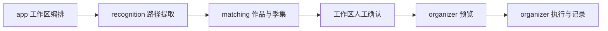

# 后端架构：三个业务模块 + Infra

JoyCurator 保持单进程、SQLite 和内嵌前端部署。主流程只有一条：



## 职责与依赖

| 包 | 职责 |
| --- | --- |
| `app` | 构造与装配、HTTP、认证和配置接入、扫描识别及人工修正的工作区流程 |
| `recognition` | 规则编译、路径提取、脚本执行、试跑、样例与历史 |
| `matching` | TMDB 查询用例、候选决策、季集校验、工作区模型 |
| `organizer` | 整理及刮削预览、确认、双通道队列、资源占用、记录、重试与撤销 |
| `model` | 跨模块共享的设置、文件、作品、季集和媒体映射值 |
| `infra/sqlite` | SQL、事务、索引及持久化；当前数据严格解码 |
| `infra/tmdb` | HTTP、连接复用、限速、重试、响应转换及缓存 |
| `infra/fsops`、`infra/scanner` | 授权文件操作、身份与磁盘检查、目录遍历 |
| `rules`、`metadata` | 命名分类和 NFO 内容生成等纯计算 |
| `auth`、`trace`、`webui` | 密码与会话、诊断事件、静态资源 |

`recognition.Metadata/Rule/Step` 属于提取，`matching.Workspace/Item` 属于匹配，`organizer.Plan/Run/Batch/Operation/Work` 属于预览和执行。HTTP DTO 保持原字段，SQLite 通过固定列与有序子表组装这些类型。

消费方定义必要的存储和外部访问接口。recognition、matching 不依赖 infra；organizer 直接使用现有授权文件能力，不为每个函数增加接口。HTTP 只调用用例，不执行 SQL、媒体遍历和文件操作。

`organizer.New(Dependencies)` 一次接收全部依赖；没有初始化后的 setter、规划提交执行回调、通用任务总线或平行的 transport/repository 层。架构约束由 `tests/scripts/architecture_test.py` 检查。

## 启动、队列与关闭

`app.Open` 创建授权文件系统、SQLite、Coordinator、TMDB Pool、识别与匹配服务、共享预览缓存、配置和工作区，最后构造 organizer，恢复持久化等待队列并启动两个 worker，再接入 HTTP。

`Coordinator` 管理 organize/scrape 两个单 worker 通道，各自的活动任务、FIFO 等待列表、取消函数和资源占用；另持有识别取消函数、关闭状态与 worker 等待计数。提交、设置保存和工作区写入复用其锁；网络及文件校验在锁外完成，提交时锁内复核快照与 revision。整理逐作品执行，多个批次按提交顺序连续执行，单部失败继续后续任务。新建、重试和撤销都在 Run 与 `execution_queue` 同一事务写入后入队；重试位置取新队列序号。

两通道启动任务时一次取得所需读写占用；冲突只等待通知，不持有部分资源。整理完成的视频须先以一个事务保存操作检查点和媒体映射，再释放该视频的写占用；同一作品后续视频仍在复制时，刮削通道即可读取已登记视频。撤销／覆盖与刮削争用同一路径会等待，等待原因由 `/queue` 返回。整理来源与全部目标在任务排队或运行期间禁止重复提交。

关闭先拒绝准入并停止出队，取消两个通道的活动任务及识别，解锁等待 worker 保存结果，保留未开始队列，再关闭 TMDB 空闲连接和数据库。运行、排队或识别未结束时，系统设置都不能保存。不得持有准入锁等待 worker。SQLite 只打开一个连接，必须关闭 rows 后再进行依赖该连接的查询或写入。

## 提取、匹配与工作区

```text
Workspace.Start → scanner.Walk → recognition.ExtractFile → matching.Resolver
  → 工作区人工确认／季集修正 → organizer.BatchPreview → ExecuteBatch
```

自动匹配和手工选择共用季集校验。原始 Metadata 与人工季集映射分开保存；预览直接使用已确认快照，不重新识别、不查询 TMDB、不探测视频。服务端保存工作区及 revision，浏览器只维护可编辑草稿和视图状态。工作区保存只提交变更文件；服务端基于原 revision 合并，拒绝修改已提交、已登记完成或状态不明的文件。作品批量操作只处理可编辑文件。`FileExecutions` 从持久化 Run 投影关联任务和锁定／完成状态，后台进度不写工作区、不增加编辑 revision；识别增量保存剥离临时投影，不覆盖运行状态。移出来源若含锁定文件则拒绝并报告任务。

正式识别逐文件保存：

```text
获取一次当前 Engine → StartTrace(running)
  → Engine.Extract：在内存收集完整步骤、规则和源码快照
  → FinishTrace：一个事务插入全部步骤并更新结果
```

正常取消、失败和优雅关闭保存已产生步骤。强制退出时当前文件可能只有运行摘要；重启标记 interrupted，不补造详情。事务失败全部回滚，不能出现一半步骤与已完成摘要。规则保存先编译再持久化替换，正在提取的文件继续使用开始时的引擎。试跑和样例不写正式历史或工作区。

TMDB Pool 复用连接池与请求起始限速，凭据、语言和诊断记录仍属于独立客户端快照。代理改变时关闭旧空闲连接，新请求使用新代理；已经发出的请求保留原快照。响应缓存仍为 24 小时，超时和重试语义保留。

## 统一预览、执行与记录

单部与多部统一经过 `/batches/preview` 和 `/batches/execute`。没有独立扫描、单作品预览执行或预览编辑／删除 API；修正工作区后重新预览。

整理预览只包含视频与同名字幕，按作品分组后检查跨作品目标冲突和合计空间；全部跳过也可执行媒体映射登记。跳过已有视频保留磁盘源文件，登记后退出整理选择。刮削只使用已登记视频，另行生成 NFO 和图片计划。

两种预览共用 `PreviewCache`：15 分钟有效，合计最多 32 份，满额仅逐出最早预览，配置保存全部失效。预览不可变，提交检查用途、有效期、配置版本、工作区 revision、源文件、目标及映射；在 Coordinator 锁内复核快照并原子写入队列，成功后消费预览，重复确认失败。有效期只限制提交，已入队任务不受缓存逐出或过期影响；出队前重新核验配置、授权、身份、冲突与空间。刮削与整理不能交叉使用预览 ID。

每部作品一条 Run，批次通过 `batchId` 关联，不新增批次表。文件操作继续按阶段持久化；识别轨迹的集中写入策略不用于文件日志。保留复制、移动、硬链接、跳过、无备份覆盖、取消、独立重试和逆序撤销。状态不明的整理操作保留现场待人工核对。每个视频完成或校验跳过后立即登记，不等整部作品结束；后续保存与重试按身份和映射归属更新，不覆盖已完成的刮削状态。共享 NFO／图片只在既有记录、内容和文件身份均吻合时复用，外部变动仍拒绝执行。

任务列表和批次轮询直接读取 Run 摘要列，不访问操作内容与媒体映射子表；单条详情按表批量读取并按 position 组装，撤销操作通过独立存储键及父子关系重建。任务和队列分页返回 `RunPage`，批次列表返回 `BatchPage`，详情从持久化任务推导状态和队列位置；启动恢复只读取 running/queued 任务。用途、批次、状态及历史路径和工作区筛选有对应索引。

## 数据与验证

仅维护当前格式；不兼容旧字段、不迁移或自动重建数据。当前格式标识为 `PRAGMA user_version=1`，schema 定义在 `infra/sqlite/schema.go`。已有库先校验格式标识和表／索引完整定义，再执行业务恢复；旧 JSON 表格式直接报错并给出路径，不重置数据。新库建表、格式标识与首次配置在同一事务提交。启动先校验队列引用和状态一致性，再将原运行任务、运行工作区和轨迹标为 interrupted；原运行任务移出队列，不自动重试，原等待任务保持序号、重新校验后续跑。数据不一致明确报错，不自动修复。凭据不返回前端或写入诊断。

所有测试在根目录 `tests/`，Go 集中测试通过 overlay 加载。执行：

```sh
make check
make build
python3 tests/run_backend.py test -tags production ./internal/webui ./internal/app
python3 tests/run_backend.py test -run '^$' -bench 'BenchmarkRecognition2000|BenchmarkWorkspace2000|BenchmarkRunHistory|BenchmarkPreview1000' -benchtime=1x ./internal/infra/sqlite ./internal/app
```

测试覆盖路径规则、匹配、工作区 revision、共享预览缓存、摘要查询、原子轨迹、多批 FIFO、双通道重叠、逐视频登记、无部分锁的资源等待、文件级编辑限制、排队／运行取消、队尾重试、撤销、关闭和重启恢复。性能样本和测量边界见 [性能记录](PERFORMANCE.md)。

### 关系表与增量检查点

- 设置、分类条件、当前规则与样例分别落表；空规则链有独立初始化标识，重启不重新填充默认规则。
- 工作区摘要、路径、文件、Metadata、季集、选中作品及候选分别落表。作品标量与演员／国家／类型集合均为工作区私有快照，不按 TMDB ID 共享可变条目；Execution 仍为实时投影，不存入工作区。
- Run 摘要、操作及撤销后代、归属路径、映射快照与已登记媒体分开保存。`sequence` 保持创建顺序，队列 `position` 独立表示本次入队顺序；Operation.ID 不充当存储主键。操作内容为 BLOB。
- 提取轨迹的 Metadata、步骤、输入、捕获、尝试、事件及规则快照均关系化；每步保存自己的规则和样例。只有 Config.Params/Value、样例 Expected、步骤 Before/After/ExtractedValue、事件 Data 使用严格 JSON，编码失败或多余 JSON 输入直接报错。
- 完整保存用于创建、结构变更与重试；`SaveCheckpoint` 仅保存 Run 摘要和指定位置的操作／映射，并原子登记已完成视频。`CheckpointWorkspace` 仅保存摘要和变化条目，以 revision 检查并在提交成功后增加 revision。后台执行投影不增加工作区 revision。
- 子表使用所属外键、级联删除、显式 position 与归属位置唯一约束。工作区 traceId 为可清理的历史引用，清理轨迹不删除工作区。多表详情通过读取事务保持同一快照。所有结果集先关闭再进行下一次查询；列表不组装操作，详情按表批量读取；单个刮削产物通过递归 CTE 只读取自身操作及撤销链。


系统维护入口由 `app/MaintenanceService` 校验截止时间与清理选项，存储实现集中在 `infra/sqlite/maintenance.go`。预览只统计，清理在同一事务删除符合结束时间的终态轨迹及过期缓存，所有轨迹子表通过外键级联删除，运行记录不参与；工作区保留可清理历史引用与原 revision。

轨迹完成使用 `traceBatch` 将不可变的新子记录按表分组、按父子依赖顺序批量插入，每条 SQL 最多 900 个绑定参数；不再为首次创建的步骤子表执行 DELETE 或 UPSERT。最终摘要、Metadata 与全部步骤仍在同一个事务提交。该策略只用于轨迹，不用于文件操作日志。

macOS 与 Linux 的 `Replace` 共用受限目录句柄、目标／暂存身份校验与独占重命名流程，旧文件在 journaled hold 路径保留至调用方清理，发布失败时尝试独占恢复，不能覆盖外部新增的目标。整理撤销在操作前核对记录身份与大小，并在检查点保存后复核，刮削继续校验内容哈希；视频不增加全文件哈希扫描。


`app/reidentify.go` 管理指定文件重跑：在 Coordinator 锁内按 revision 校验、检查执行投影并持久化 reidentifying 标记后才启动 worker；任务副本独立于 HTTP 回执。只读取／重建标记条目的原始 Metadata、轨迹和匹配结果，沿用十条批次增量检查点；人工作品快照及季集保留。匹配失败和取消／重启后仍可用普通重试入口继续标记范围，不重扫其他来源。规则配置不变，当前 SQLite schema 无需调整。

刮削预览使用 `ScrapePreviewRequest{Paths,Content,OnlyMissing}`，内容选择在构建操作前过滤；仅 NFO 不调用 Artwork，图片模式不序列化 NFO。只补缺失在目标普通文件检查后跳过，预览保留跳过清单但不创建占有这些文件的操作；只把有实际操作归属的视频映射放入缓存 Plan 和 Run。缺失文件在确认／出队前出现时仍严格复核，不覆盖外部文件。取消、重试、共享产物及撤销继续依据既有操作与 owner/owners 快照。
