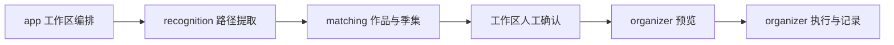

# 后端架构：三个业务模块 + Infra

JoyCurator 保持单进程、SQLite 和内嵌前端部署。主流程只有一条：



## 职责与依赖

| 包 | 职责 |
| --- | --- |
| `app` | 构造与装配、HTTP、认证和配置接入、扫描识别及人工修正的工作区流程 |
| `recognition` | 规则编译、路径提取、脚本执行、试跑、样例与历史 |
| `matching` | TMDB 查询用例、候选决策、季集校验、工作区模型 |
| `organizer` | 整理及刮削预览、确认、执行互斥、队列、记录、重试与撤销 |
| `model` | 跨模块共享的设置、文件、作品、季集和媒体映射值 |
| `infra/sqlite` | SQL、事务、索引及持久化；当前数据严格解码 |
| `infra/tmdb` | HTTP、连接复用、限速、重试、响应转换及缓存 |
| `infra/fsops`、`infra/scanner` | 授权文件操作、身份与磁盘检查、目录遍历 |
| `rules`、`metadata` | 命名分类和 NFO 内容生成等纯计算 |
| `auth`、`trace`、`webui` | 密码与会话、诊断事件、静态资源 |

`recognition.Metadata/Rule/Step` 属于提取，`matching.Workspace/Item` 属于匹配，`organizer.Plan/Run/Batch/Operation/Work` 属于预览和执行。类型移动不改变其持久化 JSON 字段。

消费方定义必要的存储和外部访问接口。recognition、matching 不依赖 infra；organizer 直接使用现有授权文件能力，不为每个函数增加接口。HTTP 只调用用例，不执行 SQL、媒体遍历和文件操作。

`organizer.New(Dependencies)` 一次接收全部依赖；没有初始化后的 setter、规划提交执行回调、通用任务总线或平行的 transport/repository 层。架构约束由 `tests/scripts/architecture_test.py` 检查。

## 启动、互斥与关闭

`app.Open` 创建授权文件系统、SQLite、Coordinator、TMDB Pool、识别与匹配服务、共享预览缓存、配置和工作区，最后构造 organizer 与 HTTP。

`Coordinator` 是执行槽、批次、识别取消函数、关闭状态和 worker 等待计数的唯一所有者。执行准入、配置保存和工作区提交复用其锁；网络校验在锁外完成，提交时锁内重查 revision。批次在作品切换间隙仍占用执行槽；单部失败继续下一部。

关闭先拒绝准入并取消任务，解锁等待 worker 保存结果，随后关闭 TMDB 空闲连接和数据库。不得持有准入锁等待 worker。SQLite 只打开一个连接，必须关闭 rows 后再进行依赖该连接的查询或写入。

## 提取、匹配与工作区

```text
Workspace.Start → scanner.Walk → recognition.ExtractFile → matching.Resolver
  → 工作区人工确认／季集修正 → organizer.BatchPreview → ExecuteBatch
```

自动匹配和手工选择共用季集校验。原始 Metadata 与人工季集映射分开保存；预览直接使用已确认快照，不重新识别、不查询 TMDB、不探测视频。服务端保存工作区及 revision，浏览器只维护可编辑草稿和视图状态。

正式识别逐文件保存：

```text
获取一次当前 Engine → StartTrace(running)
  → Engine.Extract：在内存收集完整步骤、规则和源码快照
  → FinishTrace：一个事务插入全部步骤并更新结果
```

正常取消、失败和优雅关闭保存已产生步骤。强制退出时当前文件可能只有运行摘要；重启标记 interrupted，不补造详情。事务失败全部回滚，不能出现一半步骤与已完成摘要。规则保存先编译再持久化替换，正在提取的文件继续使用开始时的引擎。试跑和样例不写正式历史或工作区。

TMDB Pool 复用连接池与请求起始限速，凭据、语言和诊断记录仍属于独立客户端快照。代理改变时关闭旧空闲连接，新请求使用新代理；已经发出的请求保留原快照。响应缓存仍为 24 小时，超时和重试语义保留。

## 统一预览、执行与记录

单部与多部统一经过 `/batches/preview` 和 `/batches/execute`。没有独立扫描、单作品预览执行或预览编辑／删除 API；修正工作区后重新预览。

整理预览只包含视频与同名字幕，按作品分组后检查跨作品目标冲突和合计空间；全部跳过也可执行媒体映射登记。跳过已有视频保留源文件和工作区选择。刮削只使用已登记视频，另行生成 NFO 和图片计划。

两种预览共用 `PreviewCache`：15 分钟有效，合计最多 32 份，满额仅逐出最早预览，配置保存全部失效。预览不可变，执行在 Coordinator 锁内检查用途、有效期、配置版本、工作区 revision、源文件、目标及映射；持久化和准入成功后消费预览，重复确认失败。刮削与整理不能交叉使用预览 ID。

每部作品一条 Run，批次通过 `batchId` 关联，不新增批次表。文件操作继续按阶段持久化；识别轨迹的集中写入策略不用于文件日志。保留复制、移动、硬链接、跳过、无备份覆盖、取消、独立重试和逆序撤销。状态不明的整理操作保留现场待人工核对。

任务列表和批次轮询在 SQL 中投影摘要，不读取操作和媒体映射详情到 Go；单条详情继续严格解码完整记录。分页返回明确的 `RunPage`，启动恢复只读取 running/queued 任务。用途、批次、状态及历史路径和工作区筛选有对应索引。

## 数据与验证

仅维护当前格式；不兼容旧字段、不迁移或自动重建数据。本轮保留表与持久化字段，只增加索引。启动将未完成任务、工作区和轨迹标为 interrupted，不自动执行文件操作。凭据不返回前端或写入诊断。

所有测试在根目录 `tests/`，Go 集中测试通过 overlay 加载。执行：

```sh
make check
make build
python3 tests/run_backend.py test -tags production ./internal/webui ./internal/app
python3 tests/run_backend.py test -run '^$' -bench 'BenchmarkRecognition2000|BenchmarkWorkspace2000|BenchmarkRunHistory|BenchmarkPreview1000' -benchtime=1x ./internal/infra/sqlite ./internal/app
```

测试覆盖路径规则、匹配、工作区 revision、共享预览缓存、摘要查询、原子轨迹、执行竞争、取消、重试、撤销、关闭和重启恢复。性能样本和测量边界见 [性能记录](PERFORMANCE.md)。
